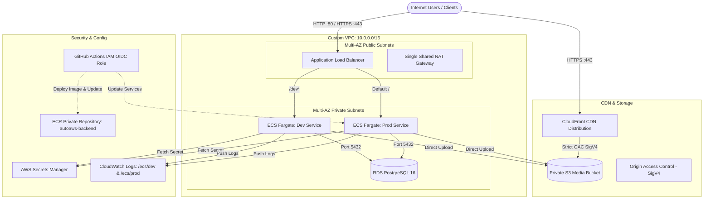

# AutoAWS

> **Production-Ready Modular AWS Infrastructure Provisioner in Terraform**  
> Architected for Node.js backends on AWS ECS Fargate (`dev` & `prod`), RDS PostgreSQL 16, S3 + CloudFront OAC, conditional Next.js AWS Amplify frontend, and zero-key GitHub Actions CI/CD via IAM OIDC.

---

## High-Level Architecture



---

## Security Group Chaining (Zero-Trust Perimeter)

Network traffic is strictly controlled using security group referencing rather than raw CIDR blocks:

```
[ Internet (0.0.0.0/0) ]
          │ Inbound 80 / 443
          ▼
┌────────────────────────┐
│  ALB Security Group    │  autoaws-dev-alb-sg
└────────────────────────┘
          │ Inbound port 3000 ONLY from alb-sg.id
          ▼
┌────────────────────────┐
│  ECS Security Group    │  autoaws-dev-ecs-sg
└────────────────────────┘
          │ Inbound port 5432 ONLY from ecs-sg.id
          ▼
┌────────────────────────┐
│  RDS Security Group    │  autoaws-dev-rds-sg (Zero outbound egress)
└────────────────────────┘
```

---

## Repository Structure

```text
AutoAWS/
├── .github/
│   ├── CODEOWNERS
│   └── workflows/
│       └── provision.yml           # GitHub Actions automated plan/apply workflow
├── modules/
│   ├── networking/                 # VPC, IGW, NAT GW, multi-AZ subnets, chained SGs
│   │   ├── main.tf
│   │   ├── variables.tf
│   │   └── outputs.tf
│   ├── database_secrets/           # RDS PostgreSQL 16, random password, Secrets Manager
│   │   ├── main.tf
│   │   ├── variables.tf
│   │   └── outputs.tf
│   ├── storage_cdn/                # Private S3 bucket, CloudFront OAC, 4-way public block
│   │   ├── main.tf
│   │   ├── variables.tf
│   │   └── outputs.tf
│   ├── ecs_node/                   # ECR, CloudWatch, ALB, Fargate task defs & services
│   │   ├── main.tf
│   │   ├── variables.tf
│   │   └── outputs.tf
│   ├── amplify_nextjs/             # Conditional Next.js SSR Amplify app & branch
│   │   ├── main.tf
│   │   ├── variables.tf
│   │   └── outputs.tf
│   └── github_repos/               # Keyless IAM OIDC Provider & GitHub Actions deploy role
│       ├── main.tf
│       ├── variables.tf
│       └── outputs.tf
├── .gitignore                      # Gitignores local state and *.tfvars
├── main.tf                         # Root orchestrator wiring all modules
├── provider.tf                     # AWS & Random providers with default resource tags
├── variables.tf                    # Root input variables with defaults and validations
├── outputs.tf                      # Core output values (ALB DNS, ECR URL, RDS, etc.)
├── terraform.tfvars                # Local configuration values (gitignored)
├── terraform.tfvars.example        # Reference configuration template
└── README.md                       # Infrastructure documentation
```

---

## Module Summary

| Module | Core Resources Created | Key Features |
| :--- | :--- | :--- |
| **`modules/networking`** | `aws_vpc`, `aws_subnet`, `aws_nat_gateway`, `aws_security_group` | Multi-AZ (2 Public, 2 Private), single shared NAT Gateway for cost savings, strict SG chaining. |
| **`modules/database_secrets`** | `aws_db_instance`, `aws_db_subnet_group`, `aws_secretsmanager_secret` | PostgreSQL 16, 32-char auto-generated password without special chars, JSON connection string stored in Secrets Manager. |
| **`modules/storage_cdn`** | `aws_s3_bucket`, `aws_cloudfront_distribution`, `aws_cloudfront_origin_access_control` | 100% private S3 bucket, CloudFront OAC SigV4, strict S3 bucket policy allowing ONLY CloudFront. |
| **`modules/ecs_node`** | `aws_lb`, `aws_ecs_cluster`, `aws_ecs_service`, `aws_ecs_task_definition`, `aws_ecr_repository` | Fargate dev & prod tasks, path-based ALB routing (`/dev*` -> dev, default -> prod), ECR lifecycle policy, CloudWatch logs. |
| **`modules/amplify_nextjs`** | `aws_amplify_app`, `aws_amplify_branch` | Conditional (`enable_amplify = false` provisions 0 resources), Next.js SSR Web Compute platform. |
| **`modules/github_repos`** | `aws_iam_openid_connect_provider`, `aws_iam_role`, `aws_iam_policy` | Keyless CI/CD authentication via GitHub OIDC with collision prevention for existing AWS accounts. |

---

## Prerequisites

- **Terraform CLI**: `v1.5.0` or later (`terraform version`)
- **AWS Account & IAM Permissions**: Administrative access or appropriate permissions to create VPC, RDS, ECS, IAM, S3, and CloudFront resources.
- **AWS Credentials**: Configured via environment variables, `~/.aws/credentials`, or the AWS CLI.

---

## Quickstart Guide

### 1. Set Your AWS Credentials

Choose one of the following methods in your terminal:

**Option A: PowerShell Environment Variables (Fastest)**

```powershell
$env:AWS_ACCESS_KEY_ID     = "AKIA..."
$env:AWS_SECRET_ACCESS_KEY = "wJalrXUtnFEMI/K7MDENG/bPxRfiCYEXAMPLEKEY"
$env:AWS_DEFAULT_REGION    = "ap-south-1"

# If using temporary credentials / AWS SSO / Academy, also set:
# $env:AWS_SESSION_TOKEN   = "IQoJb3JpZ2luX2VjE..."
```

**Option B: Standard AWS CLI / Credentials File**

```powershell
aws configure
# Enter Access Key, Secret Key, and Region (e.g., ap-south-1)
```

---

### 2. Configure `terraform.tfvars`

Edit [`terraform.tfvars`](file:///d:/AutoAWS/terraform.tfvars) to customize your deployment:

```hcl
aws_region   = "ap-south-1"
project_name = "autoaws"
environment  = "dev" # "dev" or "prod"

# Keep true for outbound internet from private tasks, or false for $0 NAT cost in testing
enable_nat_gateway = true

# Set false if your AWS account ALREADY has a GitHub OIDC provider registered
create_github_oidc_provider = true

github_org  = "Aayushffc"
github_repo = "AutoAWS"

# Enable AWS Amplify Next.js frontend if needed
enable_amplify = false
```

---

### 3. Initialize & Validate Terraform

```powershell
# Initialize provider plugins and local modules
terraform init

# Validate configuration syntax and types
terraform validate
```

---

### 4. Review Plan & Apply

```powershell
# Review proposed AWS resource changes
terraform plan

# Apply infrastructure deployment
terraform apply
```

Upon successful completion, Terraform outputs all critical endpoints and credentials:

```text
Outputs:

alb_dns_name           = "autoaws-alb-123456789.ap-south-1.elb.amazonaws.com"
ecr_repository_url     = "123456789012.dkr.ecr.ap-south-1.amazonaws.com/autoaws-backend"
rds_endpoint           = "autoaws-dev-postgres.c123456789.ap-south-1.rds.amazonaws.com:5432"
secrets_manager_arn    = "arn:aws:secretsmanager:ap-south-1:123456789012:secret:/autoaws/database-xxxxxx"
cloudfront_domain_name = "d123456abcdef8.cloudfront.net"
s3_bucket_name         = "autoaws-media-dev"
github_actions_role_arn = "arn:aws:iam::123456789012:role/autoaws-dev-github-actions-deploy-role"
```

---

## Important Architectural Solutions

### 1. ECS Health Check Crash Loop Resolution

- **Problem**: Raw `public.ecr.aws/docker/library/node:20-alpine` runs an interactive Node REPL and immediately stops in headless Fargate containers, triggering endless task restart loops and ALB `/health` failures.
- **Solution**: AutoAWS includes a default `container_command` that spins up a lightweight inline Node.js HTTP server on port 3000 responding with `HTTP 200 OK` on `/health` and `/`.
- **Switching to Your Real Backend**: Once your application Docker image is pushed to ECR:

  ```hcl
  # In terraform.tfvars:
  container_image   = "<your-account-id>.dkr.ecr.ap-south-1.amazonaws.com/autoaws-backend:latest"
  container_command = [] # Disables inline mock server; uses your Dockerfile ENTRYPOINT / CMD
  ```

### 2. AWS IAM OIDC Provider Collision Prevention

- **Problem**: AWS IAM only allows **one** OIDC provider for `token.actions.githubusercontent.com` per account. Duplicate creation fails with `EntityAlreadyExists`.
- **Solution**: If your AWS account already has an OIDC provider, set `create_github_oidc_provider = false` in `terraform.tfvars`. The deployment role will automatically attach to the existing provider ARN without error.

### 3. NAT Gateway Running Cost Optimization

- **Problem**: NAT Gateways cost ~$32/month (~$0.045/hr) each even when idle.
- **Solution**: AutoAWS uses **one single shared NAT Gateway** across public subnets instead of one per AZ. For temporary test sandboxes, set `enable_nat_gateway = false` in `terraform.tfvars` for a **$0 NAT bill**.

---

## Deploying Your Own Backend Application

1. **Authenticate Docker with ECR**:

   ```powershell
   aws ecr get-login-password --region ap-south-1 | docker login --username AWS --password-stdin <your-account-id>.dkr.ecr.ap-south-1.amazonaws.com
   ```

2. **Build and Tag Your Docker Image**:

   ```powershell
   docker build -t autoaws-backend:latest .
   docker tag autoaws-backend:latest <your-account-id>.dkr.ecr.ap-south-1.amazonaws.com/autoaws-backend:latest
   ```

3. **Push to ECR**:

   ```powershell
   docker push <your-account-id>.dkr.ecr.ap-south-1.amazonaws.com/autoaws-backend:latest
   ```

4. **Update `terraform.tfvars`**:

   ```hcl
   container_image   = "<your-account-id>.dkr.ecr.ap-south-1.amazonaws.com/autoaws-backend:latest"
   container_command = []
   ```

   Then run `terraform apply`.

---

## Teardown / Destroy

To prevent unexpected AWS charges when you are done testing:

```powershell
terraform destroy
```

*Review the resources to be deleted and type `yes` to confirm.*

---

## License

Internal infrastructure template maintained by `@Aayushffc`.
